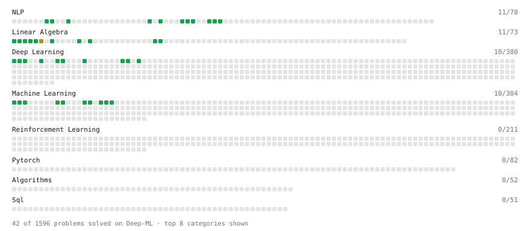

# Deep-ML

My machine learning practice from [Deep-ML](https://www.deep-ml.com). Every solution here was written by hand.

**Completed:** Pandas (8/8)

**59** solved · 59 problems · 0 labs · 0 math

[**Browse the interactive portfolio**](https://YavuzahmetR.github.io/deep-ml/) to replay this filling in over time.

## Problems

| | Difficulty | Solved | |
| --- | --- | --- | --- |
| [Add a Per-Group Average Column with GroupBy Transform](https://www.deep-ml.com/problems/1136) | easy | 2026-10-21 | [solution](problems/1136-add-a-per-group-average-column-with-groupby-transform) |
| [Batch Iterator for Dataset](https://www.deep-ml.com/problems/30) | easy | 2026-10-16 | [solution](problems/0030-batch-iterator-for-dataset) |
| [Calculate 2x2 Matrix Inverse](https://www.deep-ml.com/problems/8) | easy | 2026-10-15 | [solution](problems/0008-calculate-2x2-matrix-inverse) |
| [Calculate Accuracy Score](https://www.deep-ml.com/problems/36) | easy | 2026-10-16 | [solution](problems/0036-calculate-accuracy-score) |
| [Calculate Cosine Similarity Between Vectors](https://www.deep-ml.com/problems/76) | easy | 2026-10-15 | [solution](problems/0076-calculate-cosine-similarity-between-vectors) |
| [Calculate Mean by Row or Column](https://www.deep-ml.com/problems/4) | easy | 2026-10-15 | [solution](problems/0004-calculate-mean-by-row-or-column) |
| [Calculate Perplexity for Language Models](https://www.deep-ml.com/problems/320) | easy | 2026-10-17 | [solution](problems/0320-calculate-perplexity-for-language-models) |
| [Calculate Unigram Probability from Corpus](https://www.deep-ml.com/problems/129) | easy | 2026-10-16 | [solution](problems/0129-calculate-unigram-probability-from-corpus) |
| [Convert Vector to Diagonal Matrix](https://www.deep-ml.com/problems/35) | easy | 2026-10-15 | [solution](problems/0035-convert-vector-to-diagonal-matrix) |
| [Dot Product Calculator](https://www.deep-ml.com/problems/83) | easy | 2026-10-15 | [solution](problems/0083-dot-product-calculator) |
| [Duplicated N-gram Coverage Ratio](https://www.deep-ml.com/problems/772) | easy | 2026-10-18 | [solution](problems/0772-duplicated-n-gram-coverage-ratio) |
| [Exact Match Benchmark Decontamination Check](https://www.deep-ml.com/problems/788) | easy | 2026-10-18 | [solution](problems/0788-exact-match-benchmark-decontamination-check) |
| [Exact Match Score with Normalization](https://www.deep-ml.com/problems/325) | easy | 2026-10-17 | [solution](problems/0325-exact-match-score-with-normalization) |
| [Feature Scaling Implementation](https://www.deep-ml.com/problems/16) | easy | 2026-10-16 | [solution](problems/0016-feature-scaling-implementation) |
| [Fill-in-the-Middle Document Transformation](https://www.deep-ml.com/problems/757) | easy | 2026-10-18 | [solution](problems/0757-fill-in-the-middle-document-transformation) |
| [Handle Missing Data in pandas (dropna/fillna)](https://www.deep-ml.com/problems/1128) | easy | 2026-10-21 | [solution](problems/1128-handle-missing-data-in-pandas-dropna-fillna) |
| [Implement a Simple Residual Block with Shortcut Connection](https://www.deep-ml.com/problems/113) | easy | 2026-10-21 | [solution](problems/0113-implement-a-simple-residual-block-with-shortcut-connection) |
| [Implement Precision Metric](https://www.deep-ml.com/problems/46) | easy | 2026-10-16 | [solution](problems/0046-implement-precision-metric) |
| [Implement ReLU Activation Function](https://www.deep-ml.com/problems/42) | easy | 2026-10-16 | [solution](problems/0042-implement-relu-activation-function) |
| [Implement Ridge Regression Loss Function](https://www.deep-ml.com/problems/43) | easy | 2026-10-16 | [solution](problems/0043-implement-ridge-regression-loss-function) |
| [Implement the ELU Activation Function](https://www.deep-ml.com/problems/97) | easy | 2026-10-16 | [solution](problems/0097-implement-the-elu-activation-function) |
| [Implement the Hard Sigmoid Activation Function](https://www.deep-ml.com/problems/96) | easy | 2026-10-16 | [solution](problems/0096-implement-the-hard-sigmoid-activation-function) |
| [Implement the SELU Activation Function](https://www.deep-ml.com/problems/103) | easy | 2026-10-21 | [solution](problems/0103-implement-the-selu-activation-function) |
| [Implement the Softplus Activation Function](https://www.deep-ml.com/problems/99) | easy | 2026-10-16 | [solution](problems/0099-implement-the-softplus-activation-function) |
| [Implement the Softsign Activation Function](https://www.deep-ml.com/problems/100) | easy | 2026-10-21 | [solution](problems/0100-implement-the-softsign-activation-function) |
| [Implement the Swish Activation Function](https://www.deep-ml.com/problems/102) | easy | 2026-10-21 | [solution](problems/0102-implement-the-swish-activation-function) |
| [Implementation of Log Softmax Function](https://www.deep-ml.com/problems/39) | easy | 2026-10-16 | [solution](problems/0039-implementation-of-log-softmax-function) |
| [Instruction Complexity Scoring via Unique Intention Tags](https://www.deep-ml.com/problems/792) | easy | 2026-10-18 | [solution](problems/0792-instruction-complexity-scoring-via-unique-intention-tags) |
| [KL Divergence Between Two Normal Distributions](https://www.deep-ml.com/problems/56) | easy | 2026-10-16 | [solution](problems/0056-kl-divergence-between-two-normal-distributions) |
| [Label Encoding for Ordinal Variables](https://www.deep-ml.com/problems/356) | easy | 2026-10-19 | [solution](problems/0356-label-encoding-for-ordinal-variables) |
| [Leaky ReLU Activation Function](https://www.deep-ml.com/problems/44) | easy | 2026-10-16 | [solution](problems/0044-leaky-relu-activation-function) |
| [Linear Kernel Function](https://www.deep-ml.com/problems/45) | easy | 2026-10-16 | [solution](problems/0045-linear-kernel-function) |
| [Linear Regression Using Gradient Descent](https://www.deep-ml.com/problems/15) | easy | 2026-10-16 | [solution](problems/0015-linear-regression-using-gradient-descent) |
| [Linear Regression Using Normal Equation](https://www.deep-ml.com/problems/14) | easy | 2026-10-16 | [solution](problems/0014-linear-regression-using-normal-equation) |
| [Matrix-Vector Dot Product](https://www.deep-ml.com/problems/1) | easy | 2026-10-14 | [solution](problems/0001-matrix-vector-dot-product) |
| [Min-Max Scaling of Feature Values](https://www.deep-ml.com/problems/112) | easy | 2026-10-19 | [solution](problems/0112-min-max-scaling-of-feature-values) |
| [One-Hot Encoding of Nominal Values](https://www.deep-ml.com/problems/34) | easy | 2026-10-16 | [solution](problems/0034-one-hot-encoding-of-nominal-values) |
| [Prompt Complexity Scoring via Intention Tag Count](https://www.deep-ml.com/problems/774) | easy | 2026-10-18 | [solution](problems/0774-prompt-complexity-scoring-via-intention-tag-count) |
| [Random Shuffle of Dataset](https://www.deep-ml.com/problems/29) | easy | 2026-10-16 | [solution](problems/0029-random-shuffle-of-dataset) |
| [Reasoning Effort System Prompt Injection](https://www.deep-ml.com/problems/761) | easy | 2026-10-18 | [solution](problems/0761-reasoning-effort-system-prompt-injection) |
| [Reshape Matrix](https://www.deep-ml.com/problems/3) | easy | 2026-10-15 | [solution](problems/0003-reshape-matrix) |
| [Scalar Multiplication of a Matrix](https://www.deep-ml.com/problems/5) | easy | 2026-10-15 | [solution](problems/0005-scalar-multiplication-of-a-matrix) |
| [Sigmoid Activation Function Understanding](https://www.deep-ml.com/problems/22) | easy | 2026-10-15 | [solution](problems/0022-sigmoid-activation-function-understanding) |
| [Single Neuron](https://www.deep-ml.com/problems/24) | easy | 2026-10-16 | [solution](problems/0024-single-neuron) |
| [Softmax Activation Function Implementation ](https://www.deep-ml.com/problems/23) | easy | 2026-10-16 | [solution](problems/0023-softmax-activation-function-implementation) |
| [Token Distribution KL Divergence Filter](https://www.deep-ml.com/problems/771) | easy | 2026-10-19 | [solution](problems/0771-token-distribution-kl-divergence-filter) |
| [Transformation Matrix from Basis B to C](https://www.deep-ml.com/problems/27) | easy | 2026-10-15 | [solution](problems/0027-transformation-matrix-from-basis-b-to-c) |
| [Transpose of a Matrix](https://www.deep-ml.com/problems/2) | easy | 2026-10-15 | [solution](problems/0002-transpose-of-a-matrix) |
| [Wu-Palmer Similarity Score for Open-ended QA Evaluation](https://www.deep-ml.com/problems/787) | easy | 2026-10-18 | [solution](problems/0787-wu-palmer-similarity-score-for-open-ended-qa-evaluation) |
| [Calculate Eigenvalues of a Matrix](https://www.deep-ml.com/problems/6) | medium | 2026-10-18 | [solution](problems/0006-calculate-eigenvalues-of-a-matrix) |
| [Clean a Messy Dataset: Dedup, Standardize, Impute](https://www.deep-ml.com/problems/1131) | medium | 2026-10-21 | [solution](problems/1131-clean-a-messy-dataset-dedup-standardize-impute) |
| [Cumulative Percentage of Scores by Bucket Within Each Grade](https://www.deep-ml.com/problems/1463) | medium | 2026-10-21 | [solution](problems/1463-cumulative-percentage-of-scores-by-bucket-within-each-grade) |
| [Filter, Group, and Aggregate a DataFrame (Top-10 by Metric)](https://www.deep-ml.com/problems/1127) | medium | 2026-10-21 | [solution](problems/1127-filter-group-and-aggregate-a-dataframe-top-10-by-metric) |
| [Handle Imbalanced Data with SMOTE](https://www.deep-ml.com/problems/357) | medium | 2026-10-20 | [solution](problems/0357-handle-imbalanced-data-with-smote) |
| [Handle Missing Data with Imputation](https://www.deep-ml.com/problems/354) | medium | 2026-10-21 | [solution](problems/0354-handle-missing-data-with-imputation) |
| [Merge Multiple DataFrames](https://www.deep-ml.com/problems/1129) | medium | 2026-10-21 | [solution](problems/1129-merge-multiple-dataframes) |
| [Outlier Detection and Removal Using IQR Method](https://www.deep-ml.com/problems/355) | medium | 2026-10-20 | [solution](problems/0355-outlier-detection-and-removal-using-iqr-method) |
| [Reshape Data with pivot_table and melt](https://www.deep-ml.com/problems/1132) | medium | 2026-10-21 | [solution](problems/1132-reshape-data-with-pivot-table-and-melt) |
| [Rolling Average over a Daily Series with Missing Dates](https://www.deep-ml.com/problems/1552) | medium | 2026-10-21 | [solution](problems/1552-rolling-average-over-a-daily-series-with-missing-dates) |

---

_This file is regenerated by Deep-ML on every push._
